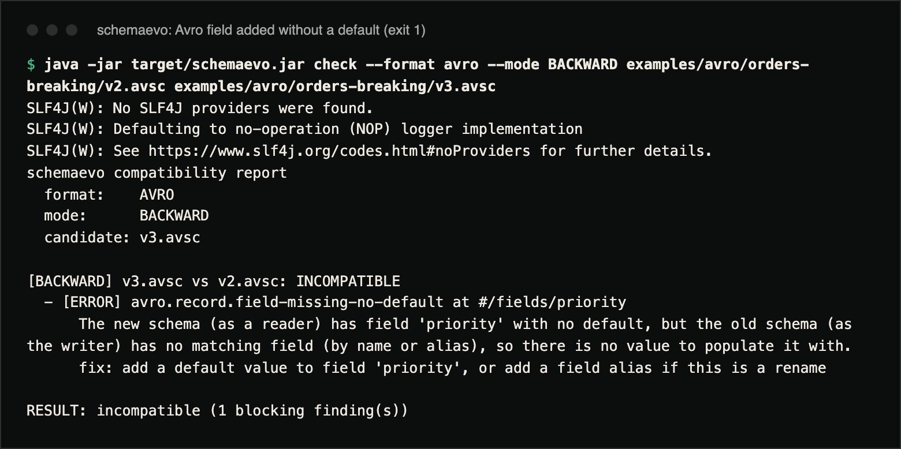
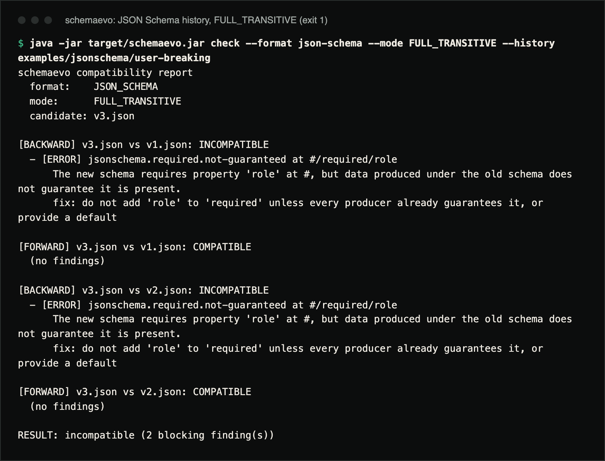
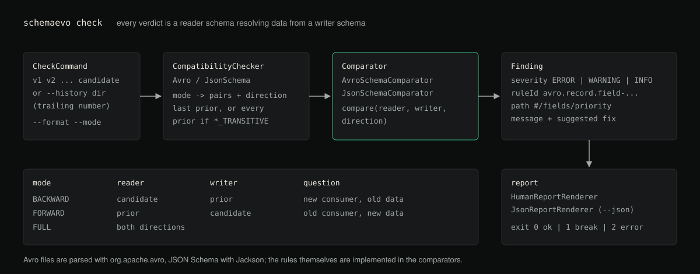

# schemaevo

A schema evolution compatibility checker for Avro and JSON Schema. For a
schema change it reports which direction breaks (old data read by the new
schema, or new data read by the old one), the rule that failed, where in the
schema, and how to fix it.

**Status:** version 1.0.0. Builds to a single shaded JAR; not published to
Maven Central. Tested in CI on JDK 21 and 25 (Ubuntu and Windows).

## Demo

Real terminal captures, run from a clone after `mvn -B package` on JDK 21.



`v3.avsc` adds a field `priority` without a default. The command exits `1`.
The three `SLF4J(W)` lines are Avro's logging notice on stderr (see
Limitations).

```console
$ java -jar target/schemaevo.jar check --format avro --mode BACKWARD examples/avro/orders-breaking/v2.avsc examples/avro/orders-breaking/v3.avsc
SLF4J(W): No SLF4J providers were found.
SLF4J(W): Defaulting to no-operation (NOP) logger implementation
SLF4J(W): See https://www.slf4j.org/codes.html#noProviders for further details.
schemaevo compatibility report
  format:    AVRO
  mode:      BACKWARD
  candidate: v3.avsc

[BACKWARD] v3.avsc vs v2.avsc: INCOMPATIBLE
  - [ERROR] avro.record.field-missing-no-default at #/fields/priority
      The new schema (as a reader) has field 'priority' with no default, but the old schema (as the writer) has no matching field (by name or alias), so there is no value to populate it with.
      fix: add a default value to field 'priority', or add a field alias if this is a rename

RESULT: incompatible (1 blocking finding(s))
```



A JSON Schema history where `v3.json` makes `role` required, checked against
every earlier version in both directions:

```console
$ java -jar target/schemaevo.jar check --format json-schema --mode FULL_TRANSITIVE --history examples/jsonschema/user-breaking
schemaevo compatibility report
  format:    JSON_SCHEMA
  mode:      FULL_TRANSITIVE
  candidate: v3.json

[BACKWARD] v3.json vs v1.json: INCOMPATIBLE
  - [ERROR] jsonschema.required.not-guaranteed at #/required/role
      The new schema requires property 'role' at #, but data produced under the old schema does not guarantee it is present.
      fix: do not add 'role' to 'required' unless every producer already guarantees it, or provide a default

[FORWARD] v3.json vs v1.json: COMPATIBLE
  (no findings)

[BACKWARD] v3.json vs v2.json: INCOMPATIBLE
  - [ERROR] jsonschema.required.not-guaranteed at #/required/role
      The new schema requires property 'role' at #, but data produced under the old schema does not guarantee it is present.
      fix: do not add 'role' to 'required' unless every producer already guarantees it, or provide a default

[FORWARD] v3.json vs v2.json: COMPATIBLE
  (no findings)

RESULT: incompatible (2 blocking finding(s))
```

## What it does

`schemaevo` compares a candidate schema against one or more prior versions and
reports, for each pair, whether the change is compatible under a chosen
guarantee (`BACKWARD`, `FORWARD`, `FULL`, or a `*_TRANSITIVE` variant checked
against the whole history). Every failure is explained in terms of a reader
(the schema decoding the data) and a writer (the schema that produced it),
with a concrete fix. It is a single JAR with a JSON output mode and exit codes,
so it can run in CI as a compatibility gate.

## Why

A schema registry will tell you a change is "incompatible". It usually will not
tell you why the specific field you touched is the problem, or what the minimal
fix is. In an event-driven system an incompatible change means a consumer fails
to decode a valid message, or decodes it into different data than the producer
intended. This tool turns "incompatible" into "a reader on the new schema
cannot read old data because field `priority` was added without a default; add
one, or add an alias if it is a rename". It does not know who your consumers
are; mapping a broken direction to the services on each side is up to you.

## Install

Requirements: JDK 21 or newer (CI uses 21 and 25) and Maven 3.9 or newer. Build the shaded JAR:

```
mvn -B package
java -jar target/schemaevo.jar --help
```

## Usage

`java -jar target/schemaevo.jar check --help` prints:

```
Usage: schemaevo check [-hV] [--json] -f=<formatArg> [--history=<historyDir>]
                       [-m=<mode>] [<files>...]
Checks a candidate schema against prior versions. Exit codes: 0 compatible, 1
incompatible, 2 usage or schema error.
      [<files>...]           Schema files: one or more prior versions followed
                               by the candidate schema
  -f, --format=<formatArg>   Schema format: avro or json-schema
  -h, --help                 Show this help message and exit.
      --history=<historyDir> Directory of numbered schema version files,
                               checked oldest to newest
      --json                 Emit a machine-readable JSON report instead of the
                               human report
  -m, --mode=<mode>          Compatibility mode: BACKWARD, FORWARD, FULL,
                               BACKWARD_TRANSITIVE, FORWARD_TRANSITIVE,
                               FULL_TRANSITIVE
  -V, --version              Print version information and exit.
```

`--mode` defaults to `BACKWARD`. With positional files, the last file is the
candidate and the others are prior versions. Non-transitive modes compare the
candidate only with the file just before it:

```
java -jar target/schemaevo.jar check \
  --format avro --mode BACKWARD \
  examples/avro/orders-breaking/v1.avsc examples/avro/orders-breaking/v2.avsc examples/avro/orders-breaking/v3.avsc
```

`--history` reads every file in a directory, ordered by the trailing number in
the file name (oldest first); the last one is the candidate:

```
java -jar target/schemaevo.jar check \
  --format avro --mode BACKWARD_TRANSITIVE \
  --history examples/avro/orders-compatible
```

Exit codes: `0` compatible, `1` incompatible, `2` usage or schema error (for
example malformed JSON or Avro, or a missing file).

`--json` prints the same result as JSON (Avro's SLF4J notice still goes to
stderr):

```json
{
  "format" : "AVRO",
  "mode" : "BACKWARD",
  "candidate" : "v3.avsc",
  "compatible" : false,
  "pairResults" : [ {
    "baseLabel" : "v2.avsc",
    "candidateLabel" : "v3.avsc",
    "direction" : "BACKWARD",
    "findings" : [ {
      "severity" : "ERROR",
      "direction" : "BACKWARD",
      "ruleId" : "avro.record.field-missing-no-default",
      "path" : "#/fields/priority",
      "message" : "The new schema (as a reader) has field 'priority' with no default, but the old schema (as the writer) has no matching field (by name or alias), so there is no value to populate it with.",
      "suggestion" : "add a default value to field 'priority', or add a field alias if this is a rename",
      "blocking" : true
    } ],
    "compatible" : false
  } ]
}
```

## Examples

- `examples/avro/orders-compatible/`: three Avro versions where every change is
  safe: a field added with a default, an enum symbol added alongside an enum
  default, and a nullable field added with a `null` default.
- `examples/avro/orders-breaking/`: `v3` adds a required `priority` field with
  no default, a `BACKWARD`-breaking change (first capture above).
- `examples/jsonschema/user-compatible/` and `examples/jsonschema/user-breaking/`:
  the same idea for JSON Schema; the breaking `v3` promotes an optional `role`
  property to `required` (second capture above).

## Compatibility modes explained

Every mode reduces to one question, asked with different schemas playing the
roles of **reader** (the schema resolving/decoding a value) and **writer**
(the schema that produced it):

| Mode | Question | Typical use |
|---|---|---|
| `BACKWARD` | Can a consumer on the **new** schema (reader) read data written under the **old** schema (writer)? | Deploy new consumers before producers upgrade. |
| `FORWARD` | Can a consumer still on the **old** schema (reader) read data written under the **new** schema (writer)? | Deploy new producers before every consumer upgrades. |
| `FULL` | Both of the above. | Deploy producers and consumers in any order. |
| `BACKWARD_TRANSITIVE` | Is the candidate `BACKWARD` compatible with **every** prior version, not just the last one? | You cannot guarantee every consumer is on the latest schema. |
| `FORWARD_TRANSITIVE` | Is the candidate `FORWARD` compatible with **every** prior version? | Same, for producers. |
| `FULL_TRANSITIVE` | Both, against every prior version. | The strictest, safest default for a shared topic. |

Non-transitive modes only compare the candidate against its immediate
predecessor. Transitive modes matter because a schema can be compatible with
`v3` while still breaking a consumer stuck on `v1`. That is common when rollout is
staggered.

For JSON Schema, the same reduction applies with "reader" replaced by
"validating schema" and "writer" by "the schema that produced the data":
`BACKWARD` asks whether every document the old schema could produce still
validates against the new schema; `FORWARD` asks the same with old and new
swapped.

## Rules reference

### Avro

| Rule | Backward-breaking? | Forward-breaking? | Notes |
|---|---|---|---|
| Add a field **with** a default | No | No | The default fills the gap for readers/writers missing it. |
| Add a field **without** a default | Yes | No | A reader on the new schema has nothing to put in that field for old data. |
| Remove a field **with** a default | No | No | Symmetric to adding one. |
| Remove a field **without** a default | No | Yes | An old reader (which still declares the field) has nothing to fill it with once the writer drops it. |
| Type promotion (`int`→`long`→`float`→`double`, `string`↔`bytes`) | No | No | Promotion is one-directional per pair; the reverse direction is a break. |
| Any other type change | Yes | Yes | No safe resolution exists. |
| Enum: add a symbol | No | Yes, unless the reader enum declares an **enum default** | A reader without the new symbol (and no default) cannot resolve it. |
| Enum: rename without an alias | Yes | Yes | Add the old name to `aliases` to rescue it. |
| Union: narrow (remove a branch a writer can still produce) | Yes | Yes | Each writer-producible type needs a resolvable reader branch. |
| Union: widen (add a branch) | No (reader side) | N/A | An unused extra reader branch is harmless. |
| Record/field/enum/fixed rename without alias | Yes | Yes | Add the old fully-qualified name (or field name) to `aliases`. |
| Record/field/enum/fixed rename **with** alias | No | No | The alias reconciles the old and new names during resolution. |
| Namespace-only change (same unqualified name) | No | No | The Avro specification matches named types by their *unqualified* name during resolution, and Avro's own `SchemaCompatibility` agrees. Renaming the type itself still needs an alias. |
| `fixed` size change | Yes | Yes | Sizes must match exactly; there is no promotion for `fixed`. |

### JSON Schema

| Rule | Backward-breaking? | Forward-breaking? | Notes |
|---|---|---|---|
| Add a `required` property | Yes | No | Old data may not have it; new data always will. |
| Remove a `required` property | No | No | Strictly loosens the schema. |
| Narrow `type` (e.g. drop an allowed type) | Yes | No | Old data of the dropped type would now fail validation. |
| Loosen `type` (e.g. add an allowed type) | No | Yes | New data of the added type would fail the old, narrower schema. |
| Add a `type` where there was none | Yes | No | The untyped side could produce any type. An untyped `enum` is judged by the types of its values. |
| `integer` data against a `number` schema | No | — | Every integer is a number; the reverse (`number` data, `integer` schema) is a break. |
| Narrow `enum` (remove a value) | Yes | No | Old data may have used the removed value. |
| Widen `enum` (add a value) | No | Yes | New data may use the new value, which the old schema rejects. |
| Add an `enum` over a previously unconstrained field | Yes | Yes | Neither side can assume the other's values fit the new set. |
| `additionalProperties: true/absent` → `false` | Yes, if the other side can produce extra properties | — | A closed schema now rejects fields the open schema allowed. |
| Tighten numeric bounds (`minimum` up, `maximum` down) | Yes | No | Values the looser schema allowed now fail. |
| Loosen numeric bounds | No | Yes | Symmetric. |
| Tighten string length (`minLength` up, `maxLength` down) | Yes | No | Same reasoning as numeric bounds. |

## Architecture

Diagram of the check flow, drawn from the source (not a screenshot):



Package layout:

```
com.schemaevo.model        Value types: CompatibilityMode, Direction, Finding,
                            PairCheckResult, CompatibilityResult, Severity.
com.schemaevo.core          CompatibilityChecker interface, SchemaEvoException.
com.schemaevo.avro           AvroSchemaComparator: the actual reader/writer
                            resolution algorithm, walking records, enums,
                            unions, arrays, maps and fixed types recursively.
                            AvroCompatibilityChecker: wires the comparator to
                            CompatibilityMode semantics (which pairs to check,
                            in which direction).
com.schemaevo.jsonschema     JsonSchemaComparator: the validating/data-schema
                            comparison over type, required, enum,
                            additionalProperties, and numeric/length bounds.
                            JsonSchemaCompatibilityChecker: same wiring as
                            above for JSON Schema.
com.schemaevo.report         Human-readable and JSON report renderers.
com.schemaevo.cli             Picocli-based command line entry point.
```

`org.apache.avro:avro` is used to *parse* `.avsc` files into a `Schema` object
model; every compatibility rule and every explanation is implemented in this
project rather than reused from Avro's own (much terser) `SchemaCompatibility`
class. The test suite cross-checks every verdict against Avro's reference
implementation (`SchemaCompatibility` for single reader/writer pairs and
`SchemaValidatorBuilder` for every mode, transitive or not); see
`AvroReferenceAgreementTest`. JSON Schema is parsed with Jackson into a plain `JsonNode` tree and
compared with a purpose-built, non-spec-complete comparator covering the
constraints listed above.

## Testing

```
mvn -B verify
```

runs the JUnit 5 suite (292 tests covering every rule above in both the
breaking and non-breaking direction, transitive checks across three versions,
malformed-schema handling, and agreement with Avro's own compatibility
checker), the Spotless formatting check and SpotBugs static analysis. CI runs
the same on JDK 21 and 25 on Ubuntu and Windows, plus a formatting and
SpotBugs job and a smoke job that runs the built JAR against the example
histories and checks the exit codes.

## Limitations

- JSON Schema support is deliberately partial: only the keywords in the table
  above are compared. `$ref`, `allOf`/`anyOf`/`oneOf`/`not`, `const`,
  `pattern`, `format`, `exclusiveMinimum`/`exclusiveMaximum`, `multipleOf`,
  tuple-form `items`, `minItems`/`maxItems` and `patternProperties` are
  ignored, so a change that only touches them is reported as compatible.
- Adding a new optional property to an *open* JSON Schema object (one that
  does not set `additionalProperties: false`) is reported as compatible, even
  though old data could in theory already carry that property with a
  different type.
- Avro logical types are ignored, as they are by Avro's own compatibility
  check: only the underlying types are compared.
- Avro's library logs through SLF4J; with no SLF4J provider on the class path
  it prints a three-line `SLF4J(W): No SLF4J providers were found` notice on
  stderr. It is harmless and does not affect the exit code.

## Security

`schemaevo` only reads local files you point it at and never makes network
calls. Schema parsing errors are reported as a message with exit code `2`, not
a stack trace. See [SECURITY.md](SECURITY.md) to report a vulnerability
privately.

## Contributing

See [CONTRIBUTING.md](CONTRIBUTING.md) (JDK 21, Maven 3.9+, `mvn -B verify`,
`mvn spotless:apply`). Changes are listed in [CHANGELOG.md](CHANGELOG.md), and
[docs/PRODUCTION_READINESS.md](docs/PRODUCTION_READINESS.md) records the last
audit.

## License

MIT. See [LICENSE](LICENSE).
